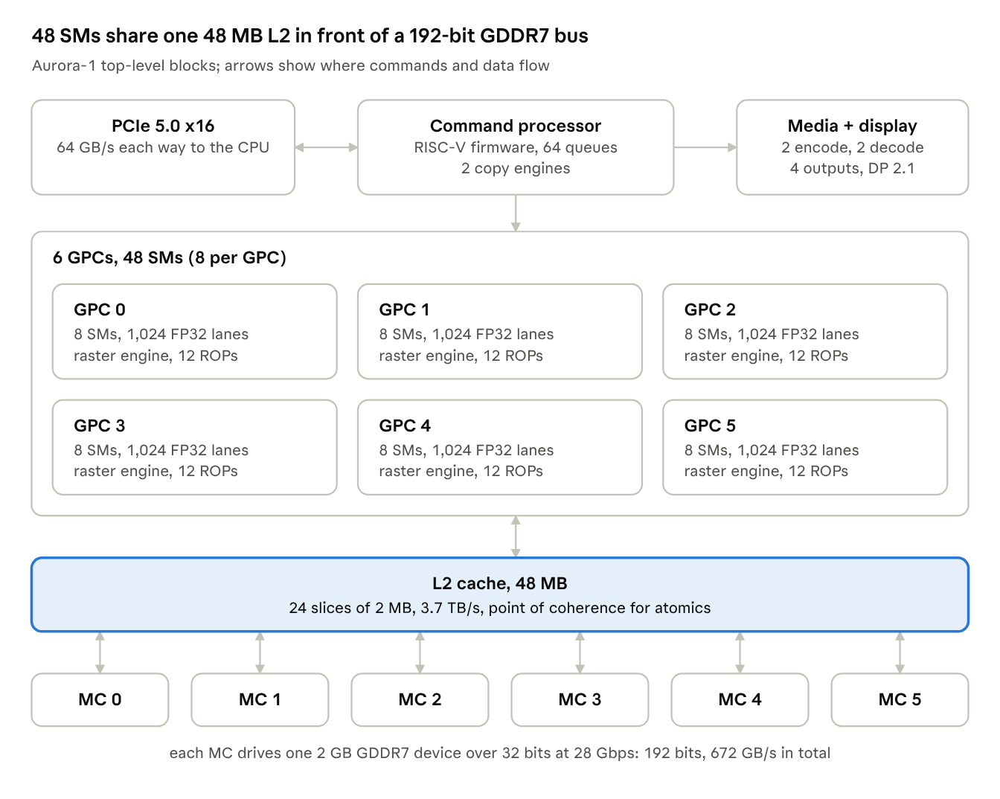

# Aurora-1 GPU Architecture Specification

Nov 23, 2026 · Saji Pillai

## Overview

Aurora-1 is a mid-range GPU for gaming and on-device AI inference. It delivers about 29.5 TFLOPS of FP32 and 236 TFLOPS of dense FP8 within a 220 W board power. It uses one monolithic die: 48 streaming multiprocessors (SMs) in 6 graphics processing clusters (GPCs), a 48 MB L2 cache and a 192-bit GDDR7 memory bus.

Design goals:

- **Balanced graphics and AI:** every SM has both shader cores and tensor units, so neither workload needs a separate chip.
- **Bandwidth through cache:** a large L2 makes up for a narrow, cheaper memory bus.
- **Simple to program:** a standard SIMT model with 32-thread warps, so existing compute and graphics compilers map onto it with little change.

All figures are design targets, not measurements.

| Spec | Target |
| --- | --- |
| Process | 3 nm-class (TSMC N3E assumed) |
| Die size | about 300 mm² |
| GPCs / SMs | 6 / 48 |
| FP32 lanes | 6,144 (128 per SM) |
| Boost clock | 2.4 GHz |
| FP32 compute | 29.5 TFLOPS |
| Tensor compute, dense | 118 TFLOPS FP16 · 236 TFLOPS FP8 · 472 TOPS FP4 |
| Ray tracing units | 48 (1 per SM) |
| Texture units / ROPs | 192 / 72 |
| L2 cache | 48 MB |
| Memory | 12 GB GDDR7, 192-bit, 28 Gbps |
| Memory bandwidth | 672 GB/s |
| Host interface | PCIe 5.0 x16 |
| Board power | 220 W |

## Top-level block diagram

Commands arrive over PCIe, the command processor spreads work across the 6 GPCs, and every SM reaches memory through the shared L2. A crossbar inside the L2 block connects any GPC to any of the 24 slices.

## Streaming multiprocessor

The SM is the unit of compute: 48 identical SMs, each split into 4 processing blocks that share an L1 cache, a texture path and a ray tracing unit. Each block issues one warp instruction per clock, so an SM issues up to 4 warp instructions per clock.

| Unit | Per processing block | Per SM | Notes |
| --- | --- | --- | --- |
| Warp scheduler + dispatch | 1 | 4 | 1 instruction per clock each |
| FP32 lanes | 32 | 128 | half also run INT32 |
| INT32 lanes | 16 | 64 | shared with FP32 issue slots |
| FP64 lanes | 1 | 4 | 1/32 rate; enough for correctness, not HPC |
| Special function units | 4 | 16 | sin, cos, exp, reciprocal, rsqrt |
| Load/store units | 8 | 32 | address generation to L1 |
| Tensor unit | 1 | 4 | 128 FP16 FMA/clock; 2× at FP8, 4× at FP4 |
| Register file | 64 KB | 256 KB | 16K × 32-bit per block |
| L1 data + shared memory | shared | 128 KB | split set by the driver per kernel |
| Texture units | shared | 4 | filtering + addressing |
| Ray tracing unit | shared | 1 | BVH traversal + triangle tests |

Occupancy limits per SM: 48 resident warps (1,536 threads), 32 thread blocks and 255 registers per thread. Full occupancy needs 42 or fewer registers per thread: 1,536 threads × 42 × 4 bytes = 252 KB, just inside the 256 KB register file. A kernel using 64 registers per thread fits 32 warps.

The tensor unit works on 16×8×16 matrix tiles taken from the register file. It supports FP16, BF16, FP8 (E4M3, E5M2) and FP4 inputs, accumulating in FP32. Sparse (2:4) weights double the throughput figures above.

## Execution model and ISA

Aurora-1 runs SIMT: threads are grouped into warps of 32 that share one instruction stream, and each thread keeps its own registers and program counter. Threads are organised as grid → thread block (up to 1,024 threads, all on one SM) → warp → thread, the same model CUDA, HIP, Vulkan compute and DirectX shaders already target.

**Scheduling.** Each warp scheduler holds up to 12 warps and picks one ready warp per clock, oldest first. A warp is ready when its operands are available: a scoreboard tracks pending register writes, so a warp waiting on memory is skipped at no cost and latency is hidden by switching warps rather than by out-of-order hardware.

**Divergence.** When threads in a warp take different branch paths:

1. The branch instruction computes a 32-bit active mask.
2. The warp runs the taken path with the other threads masked off.
3. It then runs the other path with the mask inverted.
4. A convergence barrier (`BSYNC`) placed by the compiler reunites the warp.

Each thread has its own program counter, so threads in one warp can wait on each other (locks, producer-consumer) without deadlock.

**Instruction encoding.** Fixed 128-bit instructions keep decode simple and leave room for control bits that the compiler sets to manage stalls.

| Field | Bits | Purpose |
| --- | --- | --- |
| Opcode | 12 | operation and data type |
| Destination register | 8 | R0–R254, R255 = zero |
| Source registers A, B, C | 24 | three operands for FMA and MMA |
| Immediate / constant offset | 32 | literal or constant-bank address |
| Predicate | 4 | 7 predicate registers + always-true; optional negate |
| Modifiers | 20 | rounding, saturation, cache hints, operand negate/abs |
| Scheduling control | 28 | stall count, yield hint, barrier wait and set masks |

Instruction classes: integer and floating-point ALU, special functions, load/store (global, shared, local, constant), texture and surface, warp shuffle and vote, atomics, matrix multiply-accumulate (`MMA`), ray tracing (`TRACE`, `HITQ`), branch and barrier.

## Memory hierarchy

The 48 MB L2 is the centre of the memory design: it should absorb about half of all DRAM traffic at 1440p, so the 672 GB/s bus behaves like roughly 1.3 TB/s. Each level below is about 5–10× slower and 10–200× larger than the one above it.

| Level | Capacity (whole chip) | Peak bandwidth | Load latency | Scope |
| --- | --- | --- | --- | --- |
| Registers | 12 MB (256 KB × 48) | about 177 TB/s | 1 clock | one thread |
| L1 / shared memory | 6 MB (128 KB × 48) | 14.7 TB/s (128 B/clock/SM) | about 30 clocks | one SM |
| L2 cache | 48 MB (24 slices × 2 MB) | 3.7 TB/s (64 B/clock/slice) | about 250 clocks | whole chip |
| GDDR7 DRAM | 12 GB (6 × 2 GB devices) | 672 GB/s | about 550 clocks | whole chip + host via PCIe |

**L1 and shared memory.** One 128 KB SRAM per SM, split per kernel into shared memory (0, 32, 64 or 96 KB) and L1 cache (the rest). Shared memory has 32 banks of 4 bytes, so a warp reading 32 consecutive words finishes in one clock. L1 caches global loads and is write-through to L2.

**L2 cache.** 24 slices of 2 MB, 16-way set-associative with 128-byte lines and write-back. Addresses are hashed across slices so no single slice becomes a hot spot. L2 is the point of coherence: atomics on global memory execute in the L2 slices.

**Memory controllers.** 6 controllers of 32 bits each, one per GDDR7 device, running PAM3 signalling at 28 Gbps per pin. Lossless delta colour compression on render targets cuts their traffic by about 30% for typical game frames.

**Virtual memory.** 49-bit virtual addresses, 4 KB, 64 KB and 2 MB pages, a 2-level TLB (per-SM L1 TLB, shared L2 TLB) and page faulting for unified memory with the host.

## Graphics pipeline

All programmable shading runs on the SMs; fixed-function hardware handles only the steps that are much cheaper in dedicated logic. Each GPC owns a raster engine and 12 ROPs, so the 6 GPCs process screen tiles in parallel. A frame flows through:

1. **Command processor** reads draw calls from the host queue and splits work across GPCs.
2. **Geometry:** mesh and task shaders (or the classic vertex → tessellation → geometry stages) run on the SMs and output triangles.
3. **Primitive setup and culling** removes back-facing, off-screen and zero-area triangles: 1 triangle per clock per GPC, 6 per clock chip-wide.
4. **Rasterisation** converts each triangle into 2×2 pixel quads within 16×16 screen tiles: 32 pixels per clock per GPC. Hierarchical Z rejects hidden tiles before shading.
5. **Pixel shading** runs on the SMs. Texture units fetch and filter: 4 per SM, 192 in total, 461 gigatexels per second at boost.
6. **ROPs** perform depth and stencil tests, blending and MSAA resolve, and write compressed colour to memory: 72 ROPs, 173 gigapixels per second.

**Ray tracing.** Each SM's ray tracing unit walks a bounding-volume hierarchy in hardware: 4 ray-box tests and 1 ray-triangle test per clock, with an on-chip stack of 8 entries per ray before spilling to L1. A `TRACE` instruction hands a ray to the unit; the warp keeps running other work and reads hits with `HITQ`. A hardware thread-reordering step regroups rays that hit the same material into the same warp, which cuts divergence in hit shaders.

**Upscaling and frame generation** run as tensor-unit kernels, not fixed-function blocks, so the algorithm can be updated in the driver.

## Host interface, power and physical design

The chip connects to the CPU over PCIe 5.0 x16 (64 GB/s each way) and draws 220 W at the board, of which about 170 W goes to the GPU die.

**Command processor.** A small embedded RISC-V core runs the firmware. It reads 64 hardware command queues: 1 graphics, 8 compute and 2 copy queues are exposed to the driver, and the rest serve virtualisation. Two copy engines move data between host and GPU memory without using the SMs.

**Media and display.** 2 video encoders (AV1, HEVC, H.264, up to 8K60) and 2 decoders (AV1, HEVC, H.264, VP9). 4 display outputs, DisplayPort 2.1 UHBR20 and HDMI 2.1.

**Power and clocks.** Each GPC, the memory system and the display/media block sit in separate power domains, so idle GPCs are power-gated and the chip falls below 15 W at the desktop. Firmware adjusts voltage and frequency every millisecond from on-die power, current and temperature sensors. Clock gating at the level of each processing block saves dynamic power when warps stall.

| Item | Target |
| --- | --- |
| Process | TSMC N3E (assumed) |
| Die size | about 300 mm² |
| Transistors | about 40 billion |
| Base / boost clock | 1.9 / 2.4 GHz |
| Supply voltage | 0.65 to 1.05 V |
| Board power | 220 W (die about 170 W, memory about 30 W, other about 20 W) |
| Idle power | under 15 W |
| Package | flip-chip BGA, 1,800 balls |

Area budget, approximate: SMs 55%, L2 cache 18%, memory interfaces 10%, raster/ROPs/geometry 7%, media, display and PCIe 6%, command processor and other 4%.

## Performance, verification and open questions

Peak figures follow from units × clock. Sustained figures are design targets that the performance model must confirm before tape-out.

| Workload | Peak | Sustained target | Limited by |
| --- | --- | --- | --- |
| FP32 shader math | 29.5 TFLOPS | 70–80% | issue rate, register pressure |
| FP8 matrix multiply (LLM prefill) | 236 TFLOPS | 60–70% | L2 and shared memory bandwidth |
| LLM token generation, 8B model at 4-bit | 168 tokens/s | about 125 tokens/s (75% of DRAM bandwidth) | 672 GB/s DRAM (4 GB of weights per token) |
| 1440p raster gaming | 173 Gpixels/s fill | high frame rates in current titles | ROPs and L2 hit rate |
| 1440p path-traced gaming | 48 RT units | 60 fps with upscaling | RT units, divergence |
| Memory copy | 672 GB/s | 90% | DRAM |

**Verification and bring-up plan:**

1. **Architecture model:** a cycle-approximate C++ simulator runs real shader and AI traces to fix unit counts and cache sizes.
2. **RTL per block:** each SM, cache, memory controller and fixed-function unit is verified against the model with constrained-random UVM tests and formal proofs for the arbiters and coherence protocol.
3. **Full-chip emulation:** the complete design runs on emulation hardware at about 1 MHz, booting firmware and the driver, and running conformance suites (Vulkan CTS, DirectX HLK, OpenCL CTS).
4. **Physical design sign-off:** timing at 2.4 GHz, power and IR drop, and design-rule checks.
5. **First silicon bring-up:** power-on, PCIe link, memory training, then conformance and performance suites; target 12 weeks from silicon to a production-candidate driver.

**Open questions:**

- [ ] Is 12 GB enough for the AI target, or should a 16 GB (3 GB GDDR7 devices) variant ship at launch?
- [ ] Can the L2 reach 50% hit rate at 4K, or does 4K need a 256-bit bus?
- [ ] Is FP64 at 1/32 rate acceptable to the compute customers we target?
- [ ] N3E wafer cost and yield at 300 mm² decide whether a smaller 32-SM die should be designed alongside.

## Scaled-down variant

A 2 mm × 2 mm version for small language models on smart glasses: [Aurora-Nano (glasses)](aurora-nano-glasses.md)
