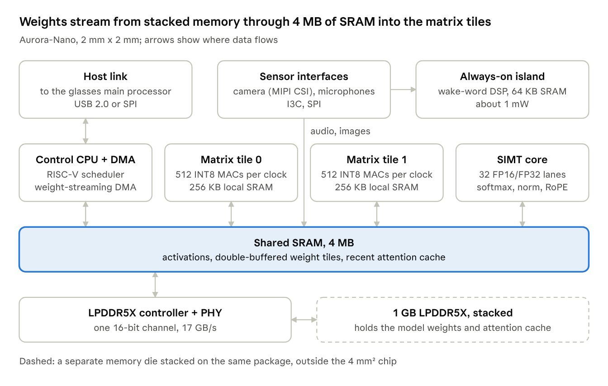

# Aurora-Nano: 2 mm × 2 mm chip for small language models on glasses

Aurora-Nano fits in 2 mm × 2 mm (4 mm²) by keeping only what a language model needs. It drops graphics, keeps Aurora-1's matrix engine and SIMT core in miniature, and reads model weights from a 1 GB memory chip stacked on top. Target: a 0.5–1B-parameter model at 4-bit, generating 15–30 tokens per second at about 200–350 mW. All figures are design targets and first-order estimates.

The chip is a neural processor (NPU) rather than a GPU: at this size every block that only serves graphics would take room from the one job that matters.

| | Aurora-1 | Aurora-Nano |
| --- | --- | --- |
| Use | gaming + AI on a PC | language model on glasses |
| Die size | about 300 mm² | 4 mm² (2 × 2 mm) |
| Process | 3 nm-class | 3 nm-class (same, for low power per operation) |
| Compute | 48 SMs | 2 matrix tiles + 1 small SIMT core |
| AI compute, dense | 236 TFLOPS FP8 | 2 TOPS INT8 · 4 TOPS INT4 |
| General-purpose lanes | 6,144 FP32 | 32 FP16/FP32 |
| Clock | 2.4 GHz | 1.0 GHz |
| On-chip memory | 48 MB L2 + 6 MB L1 | 4 MB shared SRAM |
| External memory | 12 GB GDDR7, 672 GB/s | 1 GB LPDDR5X stacked on the package, 17 GB/s |
| Graphics, ray tracing, display, video | yes | none (the glasses' display chip handles these) |
| Power | 220 W | 200–350 mW active, about 1 mW listening for a wake word |

## Why memory, not compute, sets the design

The model cannot live on the chip: a 0.5B model at 4-bit is 250 MB, while the whole 4 mm² would hold only about 12 MB of SRAM. So weights sit in the stacked LPDDR5X, and each generated token must read every weight once.

```latex
\text{tokens per second} \approx \frac{\text{memory bandwidth} \times 0.75}{\text{model size in bytes}}
```

With a 16-bit LPDDR5X-8533 channel at 17 GB/s, a 250 MB model peaks at 68 tokens/s and realistically reaches about 50. Compute is not the limit: generating one token of a 1B model takes about 2 billion operations, so even 50 tokens/s uses 5% of the 2 TOPS engine.

Energy follows the same logic. Reading a bit from LPDDR5X costs about 4 pJ, roughly 10–20 times a 4-bit multiply-add on chip. A token of a 0.5B 4-bit model therefore costs about 8 mJ in memory reads and 2 mJ for everything else.

This drives four design choices:

1. **Stack the memory on the package.** Short wires cut energy per bit and keep the glasses' board small.
2. **Read each weight exactly once per token.** A DMA engine streams the next layer's weights into a double buffer while the current layer computes, so the engine never waits and nothing is read twice.
3. **Keep weights compressed.** 4-bit weights with one FP16 scale per 32 values are unpacked inside the matrix tiles, never in memory.
4. **Process prompts in batches.** Reading a prompt (prefill) reuses each weight across many tokens, so it is compute-bound: a 256-token prompt on a 1B model takes about 0.3 s.

## Block diagram



The DMA streams each layer's weights from the stacked memory into SRAM while the matrix tiles work on the layer before, so the tiles never wait on memory. The SIMT core handles the small non-matrix steps between layers.

## Area budget

The blocks add up to 3.7 mm², leaving 0.3 mm² (8%) of margin inside the 4 mm². Shared SRAM is the largest single block, as it is in Aurora-1.

| Block | What it does | Area (mm²) |
| --- | --- | --- |
| Shared SRAM, 4 MB | activations, double-buffered weight tiles, recent attention (KV) cache | 1.00 |
| Power, clocks, I/O pads | regulators, PLL, bumps around the die | 0.80 |
| 2 matrix tiles | 512 INT8 multiply-accumulates per clock each, 256 KB local SRAM each | 0.60 |
| LPDDR5X controller + PHY | one 16-bit channel to the stacked 1 GB memory | 0.60 |
| Sensor and host interfaces | MIPI CSI camera, PDM microphones, I3C, SPI, USB 2.0 | 0.30 |
| SIMT core | 32 FP16/FP32 lanes for softmax, normalisation, rotary embeddings, sampling | 0.25 |
| Control CPU + DMA | RISC-V core running the scheduler and firmware, weight-streaming DMA | 0.15 |
| **Total** | | **3.70** |

The always-on wake-word island (a tiny DSP plus 64 KB SRAM, about 0.03 mm²) sits inside the interfaces block and keeps running when the rest of the chip is powered off.

## Power and performance on glasses

A 0.5B or 1B model at 4-bit is the sweet spot. Either answers faster than people read (about 5–10 tokens/s) and costs 5–10% of a typical glasses battery for 200 answers a day. A 1.5B model fits in memory but runs too hot for a frame that sits against the head.

Assumptions: weights at 4-bit plus scales, 75% of the 17 GB/s memory bandwidth used, a 1.2 Wh glasses battery, answers of 100 tokens, and a sustained heat limit of about 350 mW for the chip.

| Model size (4-bit) | Weights in memory | Max tokens/s | Energy per token | Power at 15 tokens/s | 200 answers a day uses |
| --- | --- | --- | --- | --- | --- |
| 0.25B | 140 MB | 90 | 6 mJ | 90 mW | 3% of battery |
| 0.5B | 280 MB | 45 | 11 mJ | 165 mW | 5% of battery |
| 1B | 560 MB | 23 | 22 mJ | 330 mW | 10% of battery |
| 1.5B | 840 MB | 15 | 33 mJ | 500 mW, over the heat limit | 15% of battery |

Other operating points:

- **Listening for a wake word:** about 1 mW, on the always-on island only.
- **Reading a 256-token prompt (1B model):** about 0.3 s at roughly 600 mW, a short burst the frame can absorb.
- **Idle, memory in self-refresh:** under 3 mW.

Context length costs bandwidth, not space. After a 1B model, 1 GB still has about 400 MB free for the attention cache. But at 8-bit each 1,000 tokens of context adds about 8 MB of reads per generated token, so an 8,000-token context slows generation by roughly 10%.

## Risks and open questions

The biggest risk is heat, not area: a glasses frame can shed only a few hundred milliwatts without feeling warm, and memory reads take most of that budget.

| Risk | Effect | Mitigation |
| --- | --- | --- |
| Frame gets warm against the temple | the chip must throttle to fewer tokens/s | cap sustained power at 350 mW; run 0.5B by default and 1B only for short answers |
| Model quality at 4-bit and 0.5–1B parameters | weaker answers than phone or cloud models | distil from a larger model; hand hard questions to the phone over Bluetooth |
| 3 nm wafer cost for a low-price product | high chip cost | the design also fits a 5 nm-class node at about 6 mm² and 20–30% more power |
| Stacked memory supply | few vendors make 1 GB LPDDR5X dies for stacking | qualify two suppliers; allow a 512 MB option for 0.5B models |

**Open questions:**

- [ ] Does the chip also run the camera's vision model, or does the glasses' main processor do that?
- [ ] Is 4-bit the floor, or should the matrix tiles support 2-bit weights to double tokens per second?
- [ ] Should the chip run on its own, or always as a co-processor beside the glasses' main processor?
- [ ] Which 0.5–1B model is the launch target? Its layer shapes set the tile and SRAM sizes.

## Tapeout package: Aurora-Nano-U

A teaching-scale version is built for IHP SG13G2 (130 nm), an open process universities can fabricate. It keeps the core operation, an INT8/INT4 matrix-vector engine with 8 multiply-accumulates per clock, with 1 KB of weights on a 2.0 × 2.0 mm die. A host loads weights and reads results over SPI. Its code and results are in this repository; see the [README](../README.md).

| Step | Status |
| --- | --- |
| RTL (Verilog) and chip top with IHP I/O pads | done |
| RTL simulation against a Python golden model | pass: 20 tests, 690 results, 2 random seeds |
| Whole-chip simulation through IHP pad models | pass |
| Synthesis to IHP standard cells | done: 0.95 mm², about 38,700 cells |
| Gate-level simulation of the synthesized netlist | pass: 3 configurations, 80 results |
| Logic timing estimate, slow corner | 7.3 ns worst path vs a 20 ns (50 MHz) clock |
| Place and route to GDSII | flow configuration ready, not yet run |
| Seal ring, DRC, LVS, fill, shuttle submission | to do, with IHP's tools and rules |
