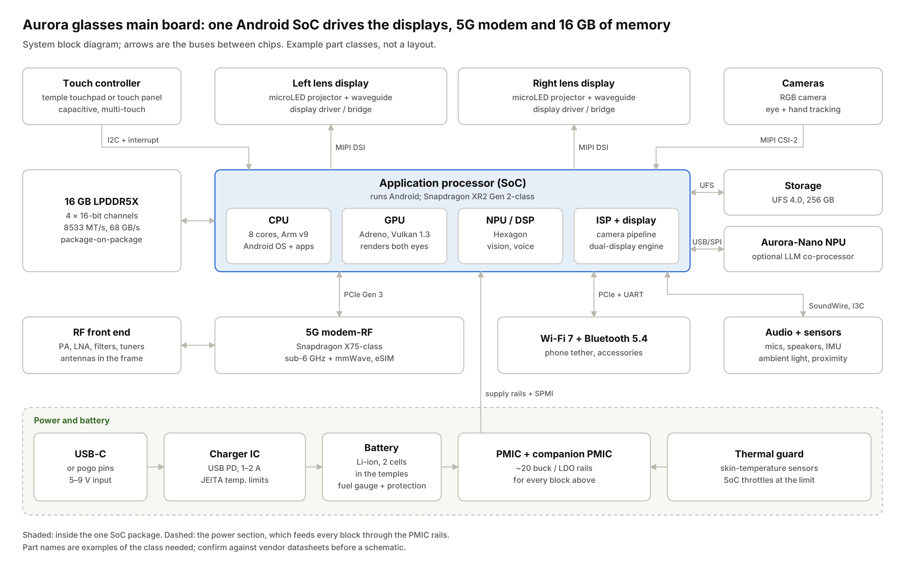

# Aurora glasses main board: system block diagram

The glasses' main board is built around one Android application processor (SoC) with its GPU on the same die, 16 GB of LPDDR5X stacked on top of it, two microLED lens displays, a touch controller, a 5G modem with its RF front end, and a power section that charges a two-cell battery and feeds every chip. The Aurora-Nano chip from this repository can sit beside the SoC as an optional language-model co-processor.

This is a system block diagram, not a schematic or a PCB layout. Part names are examples of the class of part needed; confirm each against the vendor's datasheet and availability before starting a schematic.

The diagram is generated by `scripts/glasses_board_diagram.py` (SVG always, PNG when `cairosvg` is installed), so it can be edited and redrawn.

## Components

| Block | What it does | Example part class | Bus to the SoC |
| --- | --- | --- | --- |
| Application processor (SoC) | runs Android, apps and the display pipeline | Qualcomm Snapdragon XR2 Gen 2-class (built for headsets and glasses) | — |
| GPU | renders both eyes' images | Adreno GPU, inside the SoC | on-die |
| Memory, 16 GB | Android, apps, GPU buffers | LPDDR5X-8533, 4 × 16-bit channels, package-on-package on the SoC | LPDDR5X, 68 GB/s |
| Storage | OS, apps, media | UFS 4.0, 256 GB | UFS, 2 lanes |
| Left and right lens displays | image on each lens | microLED projector + waveguide per eye, with its display driver or bridge chip | MIPI DSI, one link per eye |
| Touch controller | swipes and taps on the temple, or a touch panel | capacitive touch controller with multi-touch | I2C + interrupt line |
| Cameras | photo, video, eye and hand tracking | 1 RGB sensor + tracking sensors | MIPI CSI-2 |
| 5G modem-RF | cellular data, eSIM | Snapdragon X75-class modem, sub-6 GHz (+ mmWave optional) | PCIe Gen 3 |
| RF front end + antennas | power amplifiers, low-noise amplifiers, filters, antenna tuners | modem vendor's matched RF front-end modules, antennas in the frame | from the modem |
| Wi-Fi 7 + Bluetooth 5.4 | phone tethering, earbuds, accessories | FastConnect 7800-class combo chip | PCIe (Wi-Fi) + UART (Bluetooth) |
| Audio + sensors | microphones, speakers, motion, light, wear detection | audio codec + amps, 6-axis IMU, ambient-light and proximity sensors | SoundWire, I3C/I2C |
| Aurora-Nano NPU (optional) | runs a 0.5–1B language model at low power | the chip described in [aurora-nano-glasses.md](aurora-nano-glasses.md) | USB 2.0 or SPI |

## Power and battery

| Block | What it does | Example part class |
| --- | --- | --- |
| USB-C or pogo pins | 5–9 V charging input | USB-C receptacle with PD controller, or magnetic pogo pins |
| Charger IC | charges the cells, limits current by temperature (JEITA) | single-cell switching charger, 1–2 A |
| Battery | two Li-ion cells, one in each temple, in parallel | about 2 × 300–400 mAh, with protection IC and fuel gauge |
| PMIC + companion PMIC | about 20 buck and LDO rails for the SoC, memory, modem, displays and sensors; controlled over SPMI | the SoC vendor's matched PMIC set |
| Thermal guard | temperature sensors near the skin and on the SoC; the SoC throttles when the frame gets warm | NTC thermistors read by the PMIC ADC |

## The power budget is the main risk

Each requested feature fits on the board, but together they draw far more power than a glasses battery and frame can handle for long. These are rough figures to size the problem, not measurements.

| Load | Typical active power |
| --- | --- |
| SoC under app + GPU load | 2–5 W |
| 5G modem + RF, transferring data | 1–3 W |
| 16 GB LPDDR5X | 0.3–1 W active; tens of mW in self-refresh |
| Two microLED displays | 0.2–0.6 W |
| Everything else (cameras, Wi-Fi, sensors) | 0.3–0.8 W |
| **Total** | **about 4–10 W** |

Two 350 mAh cells hold about 2.7 Wh, so a full-load session lasts roughly 15–40 minutes, and a glasses frame can only shed about 1–2 W before it feels warm against the head. Ways to close the gap:

1. **Run the SoC well below its peak**, using the GPU for short bursts and the NPU (or Aurora-Nano) for always-on AI.
2. **Keep 5G off by default** and use Bluetooth or Wi-Fi to a phone, switching to 5G only when no phone is nearby.
3. **Drop to 8 GB of memory** if the apps allow it: 16 GB is phone-flagship size and costs board area, standby power and money.
4. **Move the battery or compute into a neck or pocket puck** connected by cable, as some headsets do, if full-time 5G and heavy apps are required.

## Notes for the PCB

- **Board shape.** The electronics split between the two temples, so a rigid-flex board fits best: a rigid main board in one temple (SoC, memory, PMIC, modem), a rigid board in the other (battery, charger, audio), and a flex through the front frame that carries the display links and the camera.
- **Layer count.** The SoC's fine-pitch package with memory on top needs an HDI board, typically 10–12 layers with stacked microvias, as in phones.
- **High-speed routing.** LPDDR5X, UFS, PCIe and MIPI need impedance-controlled pairs with length matching; keep the memory under the SoC (package-on-package) so its traces stay on the package.
- **RF.** Keep the modem and RF front end next to the antennas, shield them with cans, and give the antennas clear space in the frame away from the battery and displays. Each 5G band needs antenna tuning and certification testing.
- **Heat.** Spread the SoC's heat into the frame with a graphite sheet or vapor chamber, and keep the hottest parts away from the skin side of the temple.

## Open questions

- [ ] Must the glasses run fully standalone on 5G, or can they lean on a phone most of the time? This sets the battery size and whether 5G is worth its power.
- [ ] Does the touch requirement mean a temple touchpad, or a touch panel on the lens or a separate screen?
- [ ] Is 16 GB set by a specific app, or can the first version ship with 8 GB?
- [ ] What target weight and battery life does the product need? Together they decide between all-in-the-frame and a separate compute puck.
