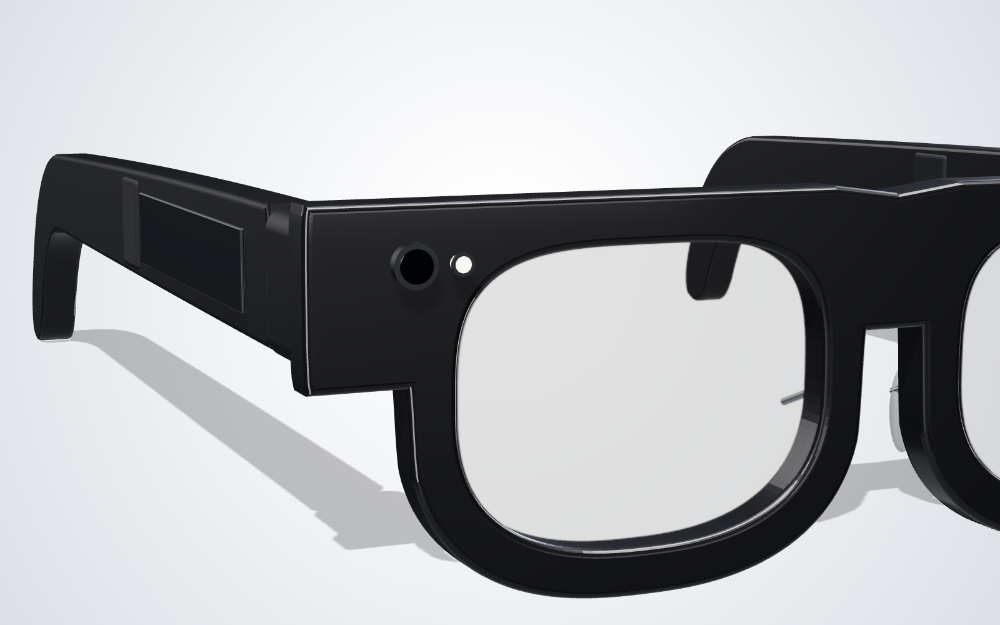
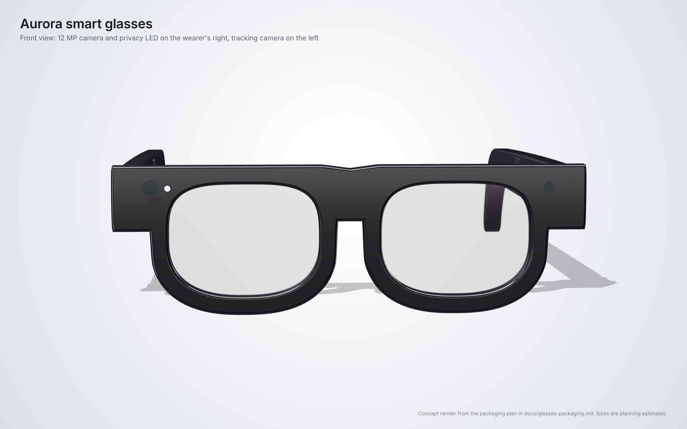

# Aurora glasses: camera system

This adds a camera system to the Aurora glasses: a 12 MP colour camera for photos, video and AI vision, a privacy LED that lights whenever that camera is powered, and a small mono tracking camera for hand and head tracking. It builds on the [main-board design](glasses-board.md), which already routed MIPI CSI-2 camera links to the SoC, and the [packaging plan](glasses-packaging.md), which reserved the two front corners of the frame for cameras.

Part names are examples of the class of part needed, not a final selection. Sizes, power and prices are planning estimates to be replaced by datasheet figures and quotes.

## What the cameras are for

| Use | Camera | Needs |
| --- | --- | --- |
| Photos and short videos from your point of view | RGB, 12 MP | good image quality in daylight and indoors, wide angle, electronic stabilisation |
| "What am I looking at?" AI questions, text reading, translation of signs, barcode and QR scanning | RGB | sharp stills on demand; low latency to the SoC's AI engine |
| Video calls showing what you see | RGB | 1080p30 streaming |
| Hand tracking (pinch, point, swipe in the air) and head tracking for anchored windows | mono tracking camera, with the RGB camera as a stereo partner when it is on | global shutter (no motion smear), wide field of view, infrared-friendly |
| Low-power wake gestures | mono tracking camera at a low frame rate | tens of milliwatts |

Eye tracking is left out of the first version: it needs two more tiny cameras and infrared LEDs inside the rim, adds about $8–15 and 100–200 mW, and the first launch apps do not need it. The frame flex keeps two spare CSI lanes so it can be added later.

## Parts

| Part | Example part class | Size (mm) | Link to the SoC |
| --- | --- | --- | --- |
| RGB camera | 12 MP, 1/2.8–1/3-inch class stacked CMOS sensor (Sony IMX or OmniVision OV class), fixed-focus wide lens about 100–110° diagonal | module about 7 × 7 × 5 | MIPI CSI-2, 4-lane D-PHY, about 2.5 Gbit/s per lane |
| Tracking camera | 1 MP or smaller global-shutter mono sensor (OmniVision OV9282 / OG0VA class), fisheye lens | about 5 × 5 × 4 | MIPI CSI-2, 1–2 lanes |
| Privacy LED | white LED behind a small diffuser in the front frame, beside the RGB lens | about 2 mm window | driven from the RGB camera's power rail (see below) |
| Camera image processing (ISP) | inside the SoC: the XR2 Gen 2 and AR1+ both include Qualcomm Spectra ISPs that handle several concurrent cameras | on-die | — |

Fixed focus keeps the RGB module small and avoids a focus motor rattling in the frame. With a wide lens and a small sensor, everything from about 30 cm to infinity stays sharp enough for photos and AI vision; close-up document reading may need a lens with a short focus range, to be tested on the proof of concept.

## Where they go

| Part | Location | Why there |
| --- | --- | --- |
| RGB camera | right front corner (the wearer's right), in the end piece above the hinge | the main board with the SoC is in the right arm, so the 4-lane CSI link only crosses the right hinge flex (about 30 mm) |
| Privacy LED | front frame, just inside the RGB lens | sits next to the lens so anyone looking at the camera sees it |
| Tracking camera | left front corner | its 1–2 lane link is slow enough to cross the frame flex and both hinges (about 150 mm) without trouble, and the 127 mm spacing from the RGB camera gives good stereo depth |

The cameras sit in the frame front, not the arms, so they always point where the wearer is looking. Both are behind a small cover glass flush with the frame. On the rimmed styles (round, panto, cat-eye and others) the end piece is the same block, so camera placement does not change between styles.

## Privacy LED: a hardware rule, not a setting

People nearby need to know when the glasses can see them. The LED is wired so software cannot turn the camera on without lighting it:

- The RGB sensor's power rail (its analog and core supplies, switched by a load switch on the main board) also feeds the LED driver. If the sensor has power, the LED is lit. There is no separate software control to turn the LED off.
- A light sensor beside the LED checks it is not covered. If it reads dark while the camera is on, capture stops and the wearer is told to uncover it, as some shipping camera glasses do.
- The LED pulses while recording video and blinks once when a photo is taken.
- The tracking camera does not light the LED: it is low resolution, mono, never saves images and its frames stay inside the SoC's secure processing area. That rule must be stated plainly in the privacy policy, and an independent audit of the tracking pipeline is worth budgeting before launch.

## Power and heat

| Mode | Extra draw | Notes |
| --- | --- | --- |
| Tracking camera on (hand tracking at 30–60 fps) | 40–80 mW sensor + 100–250 mW SoC processing | runs only while a hand-tracked app is open |
| Tracking camera, low-rate wake gestures | 15–30 mW | optional |
| Taking a photo | about 0.6–1 W for under a second | negligible over a day |
| AI vision question (one still to the on-device model or the cloud) | about 1–2 W for 1–3 s | about the same cost as a voice question with the radio on |
| Recording 1080p30 video with stabilisation | about 0.9–1.5 W (sensor 0.15–0.25 W, ISP and encoder 0.5–0.9 W, storage 0.1 W) | the frame can only shed 1–2 W in total, so video is limited to clips |
| Streaming video on a call | about 1.5–2.5 W including Wi-Fi or 5G | the hardest case; expect 10–20 minutes before the frame warms and the SoC throttles |

So that the cameras fit inside the [power budget](glasses-board.md#the-power-budget-is-the-main-risk):

- **Video is clip-based**: up to 3 minutes per clip by default at 1080p30, with an optional higher resolution for shorter clips. That matches what camera glasses on sale today do for the same reason.
- **Everything else is on demand**: no always-on RGB camera; the AI assistant grabs a single frame when asked.
- **The camera's heat lands in the right arm**, where the graphite spreader already carries SoC heat outward. The thermal sensors there cap video length as the arm warms.

A day with 20 photos, 5 short clips, 30 AI vision questions and 20 minutes of hand tracking uses about 0.15–0.25 Wh, roughly 6–9% of the 2.7 Wh battery.

## Weight and space

The RGB module, LED and tracking camera together add about 2–3 g and replace the two generic 5–7 mm camera blocks already in the packaging plan, so the 65–85 g weight estimate does not change. The RGB module is the tallest part in the end piece; at 7 mm square it fits the end-piece block of every frame style, but it sets the minimum end-piece height at about 9 mm.

## Cost

| | Prototype (10–100 units) | Volume (10k–100k units) |
| --- | --- | --- |
| 12 MP RGB camera module with lens | $18–35 | $8–12 |
| Tracking camera module | $10–18 | $4–7 |
| Privacy LED, light sensor, cover glasses, camera flex | $4–8 | $2–3 |
| **Camera system** | **$32–61** | **$14–22** |
| Previous estimate ("Cameras (RGB + tracking)") | $20–40 | $10–20 |
| **Change per unit** | **about +$12–21** | **about +$3–4** |

One-time costs the camera adds:

| Item | Low | High |
| --- | --- | --- |
| Camera image-quality tuning: colour, exposure, noise and stabilisation tuning of the ISP for this sensor and lens, done with the ODM or a Qualcomm-approved tuning lab | $120k | $300k |
| Camera test fixtures for the factory line (focus and colour checks on every unit) | $30k | $100k |
| **Total** | **$150k** | **$400k** |

These are folded into the [cost and sourcing estimate](glasses-cost-and-sourcing.md) and the [funding requirement](glasses-funding-requirement.md).

## Rules and certification

- **No new radio certification**: the cameras are not radios. EMC testing covers them in the normal FCC and CE runs.
- **Privacy law**: recording people in public is legal in most of the US and EU, but some places (some EU states, workplaces, schools, hospitals, changing rooms) restrict it. The companion app should let businesses turn the camera off by policy, and the glasses should honour that.
- **GDPR**: faces captured by the glasses are personal data. Photos stay on the glasses and the paired phone unless the wearer shares them; AI vision frames sent to the cloud are deleted after the answer and never used for training without opt-in.

## Next steps

- [ ] Put a 12 MP module and a tracking camera on the proof-of-concept frame and measure power, heat and image quality.
- [ ] Ask the ODM which sensors Qualcomm has already tuned for the chosen SoC; using one of those cuts the tuning cost toward the low end.
- [ ] Decide fixed focus or a short-range focus lens after testing document reading.
- [ ] Prototype the LED power-rail circuit and the covered-LED check on the EVT board.
