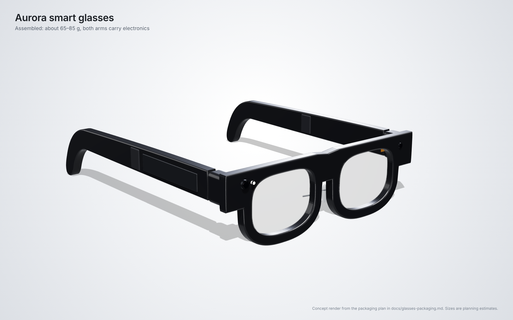
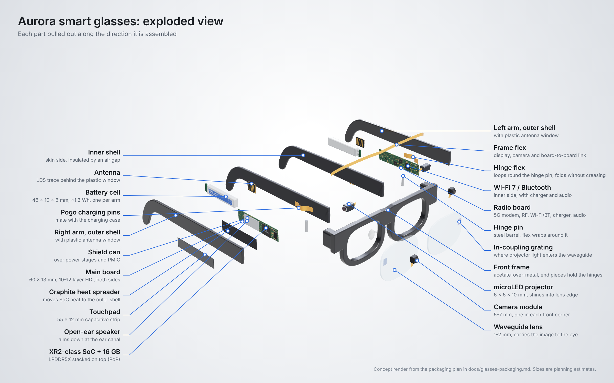
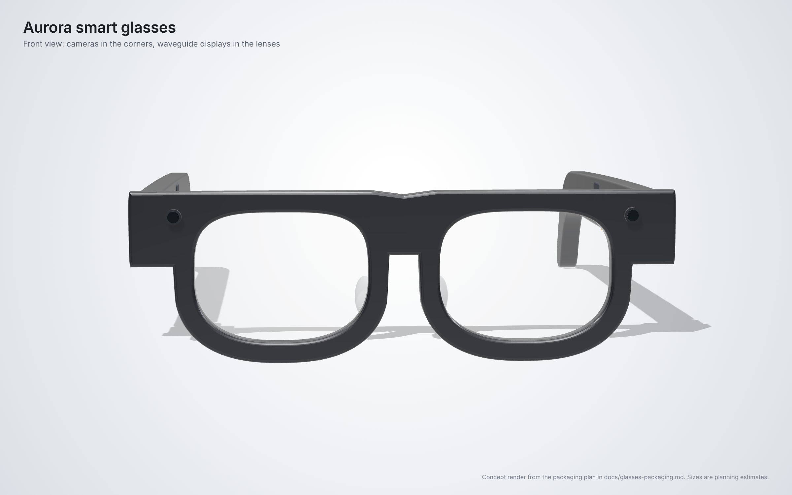

# Aurora glasses: funding requirement

This is the funding case for taking the Aurora smart glasses from concept to a first production run of 5,000 units. It turns the [cost and sourcing estimate](glasses-cost-and-sourcing.md) into a staged ask with use of funds, milestones, team, unit economics and risks. The technical design behind it is in the [main-board design](glasses-board.md) and the [packaging plan](glasses-packaging.md).

## The ask

**About $16M in total, raised in three stages over about 30 months.** Each stage is released only when the stage before hits its milestones, so investors fund the next risk only after the last one is retired.

| Stage | Amount | Months | What it proves |
| --- | --- | --- | --- |
| 1. Pre-seed | **$650k** | 0–6 | The display, apps, battery life and heat work on a working proof of concept, and an ODM will build it |
| 2. Seed | **$3.2M** | 6–15 | Custom engineering prototypes (EVT) work end to end and pilot users want them |
| 3. Series A | **$12.4M** | 15–30 | The product passes certification, the factory line yields, and the first 5,000 units ship |
| **Total** | **$16.25M** | 30 | |

The realistic range for the full plan is **$12M–20M**, depending on supplier quotes, team location and how many prototype rounds are needed. A leaner version that pairs with a phone instead of carrying its own 5G costs about **$10M** (see [A leaner path](#a-leaner-path-about-10m)).

All figures are planning estimates built from typical industry rates, not quotes. Replace each with a real quote before sending this to investors (see [Before you send this](#before-you-send-this)).

## The product

Aurora is a pair of standalone display glasses: Android apps on a full-color microLED display in each lens, cameras, a temple touchpad, 5G, Wi-Fi and Bluetooth, with on-device AI.

| | |
| --- | --- |
| Processor | Qualcomm Snapdragon XR2 Gen 2-class, 16 GB memory, 256 GB storage |
| Display | two full-color microLED projectors with waveguide lenses |
| Connectivity | 5G sub-6 GHz, Wi-Fi 7, Bluetooth 5.4 |
| Weight | about 65–85 g (target to bring down) |
| Battery | about 2.7 Wh across two cells, one in each arm |
| Target retail price | about $1,500 |
| Volume unit cost | about $500–850 |

The longer-term difference is the **Aurora-Nano** chip from this repository: a 2 × 2 mm language-model processor designed to run a small AI model on the glasses at a fraction of the main processor's power ([design](aurora-nano-glasses.md)). The first product uses the Qualcomm processor's built-in AI engine. Developing a production 3 nm Aurora-Nano is a separate chip program costing tens of millions of dollars and is **not** in this ask; this ask funds keeping its board footprint and software interface ready for a later version.

## Stage 1: Pre-seed, $650k, months 0–6

| Use of funds | Amount |
| --- | --- |
| Team: 4 people for 6 months (founder, hardware lead, Android engineer, optics/mechanical engineer) | $410k |
| Proof-of-concept hardware: Qualcomm development kit, microLED and waveguide evaluation kits, 3D-printed frames | $120k |
| Company setup, legal, patent filings | $50k |
| Supplier and ODM engagement, NDAs, factory visits | $30k |
| Contingency | $40k |
| **Total** | **$650k** |

**Milestones to unlock the seed round**

- A proof of concept worn on the head that shows Android apps on the display.
- Measured power and heat, with a plan that reaches at least 2 hours of mixed use.
- The architecture decided: standalone 5G or phone pairing, 16 or 8 GB, XR2 Gen 2 or Snapdragon AR1+ (the [open questions](glasses-board.md#open-questions)).
- Signed quotes or a letter of intent from at least one ODM (for example Goertek or Thundercomm) and access to Qualcomm's reference design.
- First patent applications filed.

## Stage 2: Seed, $3.2M, months 6–15

| Use of funds | Amount |
| --- | --- |
| Team: growing from 4 to about 12, averaging 10 people for 9 months | $1.53M |
| ODM or design-house engineering for the first custom design (boards, RF, optics, mechanics) | $700k |
| Two engineering-prototype (EVT) builds, about 50 units each | $300k |
| Display and optics samples, lab and test equipment | $150k |
| Pre-compliance radio and SAR testing | $60k |
| Software tools, licenses, cloud | $60k |
| Office, operations, legal, insurance | $100k |
| Contingency | $300k |
| **Total** | **$3.2M** |

**Milestones to unlock the Series A**

- EVT units working end to end: display, touch, cameras, audio, Wi-Fi, Bluetooth and 5G (if kept) on the custom boards.
- Battery life and surface temperature within target on EVT units.
- Pre-compliance radio and SAR scans passed, so certification is low risk.
- 50 or more units in pilot users' hands, with usage data.
- Demand evidence: pre-orders, a waitlist, or letters of intent from business customers.

## Stage 3: Series A, $12.4M, months 15–30

| Use of funds | Amount |
| --- | --- |
| Team: about 16 people on average for 15 months | $4.08M |
| ODM engineering for design and production validation (DVT, PVT) and line setup | $600k |
| DVT and PVT builds, about 300 units | $450k |
| Production tooling: molds, hinges, battery tooling, test fixtures | $350k |
| Certification: FCC, CE, PTCRB/GCF, two US carriers, battery and eye safety, Bluetooth and Wi-Fi | $600k |
| Reliability testing: drop, sweat, hinge-cycle, battery | $150k |
| First production run: 5,000 units at about $750 each | $3.75M |
| Launch and marketing | $1.0M |
| Operations, legal, insurance, customer support setup | $300k |
| Contingency | $1.12M |
| **Total** | **$12.4M** |

The first production run is about a third of this stage. Part of it can be covered by pre-order cash, ODM payment terms or inventory financing, which would reduce the equity needed by up to about $3M.

**Milestones at the end of the Series A**

- All launch certifications granted (US and EU, at least one US carrier).
- Factory yield above 90% at PVT.
- First 5,000 units shipped to customers.
- Unit cost on a path to under $650 at the next order size.

## How this compares with the development cost estimate

The [cost estimate](glasses-cost-and-sourcing.md) puts one-time development at $3.5M–10M. This ask is larger because it also pays for things a development budget leaves out:

| | Amount in this plan |
| --- | --- |
| Development: engineering team, ODM engineering, prototypes, tooling, certification, testing, tools | about $9.6M |
| Contingency across all three stages | about $1.5M |
| First 5,000 units of inventory | $3.75M |
| Launch and marketing | $1.0M |
| Company running costs (office, legal, insurance, support) | about $0.5M |
| **Total** | **about $16.25M** |

The development part, with its contingency, sits at the top of the $3.5M–10M range because this plan budgets a full in-house team for 30 months rather than relying mostly on an ODM's reused design.

## Team and hiring plan

| Role | Pre-seed | Seed | Series A |
| --- | --- | --- | --- |
| Founder / CEO | 1 | 1 | 1 |
| Hardware lead (electrical, PCB) | 1 | 1 | 1 |
| Electrical and RF engineers | | 2 | 3 |
| Optics and display engineer | 1 | 1 | 2 |
| Mechanical and industrial design | (shared with optics) | 1 | 2 |
| Android platform and driver engineers | 1 | 3 | 4 |
| App and AI engineers | | 2 | 3 |
| Supply chain and manufacturing lead | | 1 | 1 |
| Quality, test and certification | | | 1 |
| Marketing, sales and support | | | 2 |
| **Headcount at end of stage** | **4** | **12** | **20** |

Team costs assume an average of about $17k per person per month fully loaded (salary, benefits, taxes, equipment), a mix of US and lower-cost locations. An all-US team in a high-cost city would add about 30–50% to the team lines; a team based mostly in Asia or Eastern Europe could cut them by a similar amount.

## Runway

| Stage | Monthly spend (average) | Runway |
| --- | --- | --- |
| Pre-seed | about $110k | 6 months |
| Seed | about $355k | 9 months |
| Series A | about $830k (about $510k excluding inventory and launch) | 15 months |

Start raising each next stage at least 4–6 months before the current one runs out. Hardware milestones often slip by a quarter, and the contingency lines are sized to cover about one slip per stage.

## Unit economics

At a $1,499 retail price and the volume cost from the [estimate](glasses-cost-and-sourcing.md#bill-of-materials-per-unit):

| Per unit | Sold direct (own website) | Sold through retailers |
| --- | --- | --- |
| Revenue to the company | $1,454 (after about 3% card fees) | about $1,050 (retailer keeps about 30%) |
| Parts and assembly | $650 | $650 |
| Cellular patent royalties | $15 | $15 |
| Packaging, freight, duties | $25 | $25 |
| Warranty and returns reserve (about 3% of price) | $45 | $45 |
| **Gross profit** | **about $720 (49%)** | **about $315 (30%)** |

The first 5,000 units cost more (about $750 each), which lowers the first-run margin to about 42% direct and 21% retail. Consumer electronics companies typically aim for 35–50% gross margin, so a direct-first launch fits; retail needs the unit cost brought down first.

**Break-even.** After launch the company spends about $430k a month to run (a team of 20 plus operations). At an average of about $500 gross profit per unit across direct and retail sales, it breaks even at about **900 units a month**, about 10,000–11,000 units a year.

## Risks and how this plan handles them

| Risk | Why it matters | How it's handled |
| --- | --- | --- |
| Battery life and heat | the full feature set draws 4–10 W against a 2.7 Wh battery and a 1–2 W frame heat limit ([power budget](glasses-board.md#the-power-budget-is-the-main-risk)) | measured in the pre-seed proof of concept before any custom board; the glasses-specific Snapdragon AR1+ and dropping always-on 5G are ready fallbacks |
| Weight and comfort | 65–85 g is heavy for all-day wear | weight target set at pre-seed; 8 GB memory, single-eye display or no 5G each save weight |
| Qualcomm access | Qualcomm sells XR chips only to approved customers under NDA | work through an ODM or design house that already holds access; this is a pre-seed milestone |
| Display supply and cost | projectors and waveguides are about half the parts cost and have limited suppliers | evaluate two waveguide suppliers early; keep a single-eye or monochrome option |
| Certification | head-worn radios face strict SAR limits; carrier approval is slow | pre-compliance scans in the seed stage; 5G carrier approval can follow launch |
| Competition | large companies sell display glasses (Meta Ray-Ban Display at $799) | differentiate on standalone apps, on-device AI and later the Aurora-Nano chip; target a niche such as business or accessibility users first |
| Schedule slip | first hardware products usually need an extra prototype round | contingency in every stage; each stage gated on milestones |
| Tariffs and supply chain | most glasses suppliers are in China | ODMs with Vietnam sites; Jabil or Flex as a US or Mexico option |

## A leaner path, about $10M

If the glasses pair with a phone instead of carrying their own 5G, use the glasses-specific Snapdragon AR1+ processor, and are built on an ODM's reference design, the plan shrinks:

| Stage | Full plan | Lean plan |
| --- | --- | --- |
| Pre-seed | $650k | $650k |
| Seed | $3.2M | about $2.5M |
| Series A | $12.4M | about $7M |
| **Total** | **about $16.25M** | **about $10M** |

The savings come from a smaller team (about 12 instead of 20 at launch), no cellular certification, no modem or cellular royalties, and a cheaper unit (about $450 instead of $750 at first run). The trade-off is that the glasses need a phone nearby for internet when away from Wi-Fi.

## Where the money can come from

- **Angel investors and hardware-focused venture funds** for the pre-seed and seed rounds.
- **Hardware accelerators** such as HAX, which invest and give access to Shenzhen manufacturing partners.
- **Strategic investors** in the supply chain: chip makers' venture arms (for example Qualcomm Ventures), ODMs and display suppliers sometimes invest or cut engineering fees for a manufacturing commitment.
- **Non-dilutive grants**: US SBIR grants (Phase I up to about $300k, Phase II up to about $1.25M, check current limits) fit the Aurora-Nano chip and on-device AI work.
- **Pre-orders and crowdfunding** to fund part of the first production run and prove demand.
- **Inventory financing and ODM payment terms** for the production run in the Series A.

## Before you send this

These parts need your input or real quotes before the document goes to investors:

- [ ] **Founder and team backgrounds**: investors fund the team first.
- [ ] **Target customer and market size**: who buys the first 5,000 and why (consumers, business, accessibility).
- [ ] **Competitor table with current prices**: Meta Ray-Ban Display, Even Realities, RayNeo, Rokid, Xreal and Vuzix.
- [ ] **Quotes** from at least one ODM, one waveguide supplier and one certification lab, replacing the estimates here.
- [ ] **The architecture decision** (full or lean plan), which sets the ask.
- [ ] **Valuation and dilution** targets for each round.

