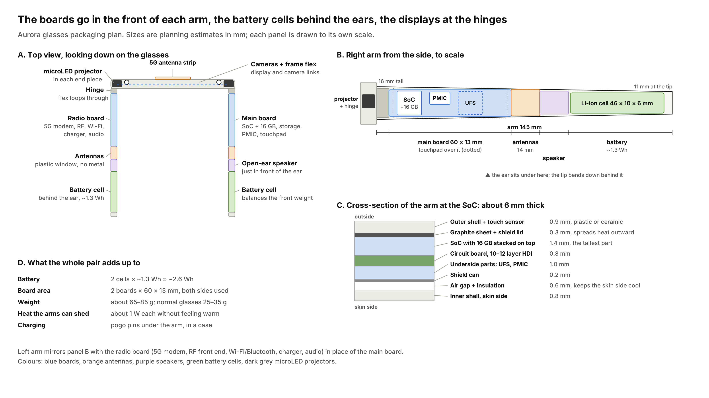

# Aurora glasses: fitting the boards and battery into the frame

This plan shows where each part of the [main-board design](glasses-board.md) sits in a pair of glasses. The electronics split into two narrow circuit boards, one in the front half of each arm. A battery cell sits in each arm behind the ear, and a microLED projector sits in each end piece beside the hinge. Flexible circuits loop through the hinges and across the front frame to tie it all together.

Every size here is a planning estimate to start a mechanical (CAD) design from, not a measured part.

The drawing is generated by `scripts/glasses_packaging_diagram.py`.

## Where each part goes

| Part | Location | Size (mm) | Why there |
| --- | --- | --- | --- |
| Main board: SoC with 16 GB on top, storage, PMIC | front half of the right arm | 60 × 13, both sides populated | the widest, stiffest part of the arm, closest to the displays |
| Radio board: 5G modem, RF front end, Wi-Fi/Bluetooth, charger, audio | front half of the left arm | 60 × 13 | keeps the modem's heat away from the SoC's, so each arm sheds its own |
| Battery cells | one per arm, behind the ear | about 46 × 10 × 6 each, ~1.3 Wh | weight behind the ear balances the displays at the front, so the glasses don't slide down the nose |
| microLED projectors | end pieces of the front frame, next to each hinge | about 6 × 6 × 10 each | they shine into the edge of each lens's waveguide, which carries the image to the eye |
| Waveguides | in the lenses | lens-sized, about 1–2 mm thick | the display surface the wearer sees |
| Cameras | front corners of the frame | 5–7 mm modules | clear forward view |
| Antennas | a plastic window in each arm between board and speaker, and a strip along the top of the bridge | 14 mm sections | antennas need gaps in any metal and space away from the battery, displays and the wearer's head |
| Touchpad | outer face of the right arm, over the main board | about 55 × 12 | where a finger naturally lands |
| Speakers | just in front of each ear | 14 mm sections | open-ear sound aimed down at the ear canal |
| Charging | pogo pins under the arm, mating with a charging case | 2–4 pins | a USB-C socket (about 9 × 3.2 mm) barely fits the arm and adds a water-ingress path |

## Fitting the boards

The arm is about 16 mm tall at the hinge and 6–7 mm thick, which leaves a board about 13 mm tall. The SoC with its 16 GB memory stacked on top is roughly 12 × 12 mm and 1.4 mm high, so it only just fits and sets the arm's minimum height. Everything else has to go around and under it:

- **Use both sides.** Tall parts (SoC, shield cans) go on the outer side, with flatter parts (UFS storage, PMIC, passives) on the inner side.
- **Phone-grade board.** A 10–12 layer HDI board with stacked microvias, 0.8 mm thick, the same kind phones use, is needed to route the SoC's dense ball grid.
- **If it doesn't fit,** stack two smaller boards in a sandwich joined by an interposer, as recent phones do, or grow the arm to about 18 mm tall at the hinge.

Panel C of the drawing shows the arm's 6 mm cross-section at the SoC: outer shell with the touch sensor, graphite heat spreader, SoC, board, underside parts, shield, an insulating air gap, and the inner shell against the head.

## Connecting the two arms

Three flexible circuits (thin polyimide cables) join the parts:

1. **A hinge flex on each side** loops around the hinge pin so it bends, not creases, when the glasses fold. It must survive tens of thousands of open-close cycles, so it needs its own bend test early.
2. **A frame flex** runs along the front frame through the bridge. It carries the far-eye display link (MIPI DSI), the cameras (MIPI CSI) and the link between the two boards.

The hardest link is between the boards: the 5G modem talks to the SoC over PCIe, and here that signal has to cross two hinges and about 150 mm of flex. That is possible with careful impedance control, but it is the riskiest connection in the design. The fallback is to put the modem on the main board next to the SoC, growing that board to about 80 mm, and leave only the RF front end, Wi-Fi and audio in the left arm.

## Heat

Each arm can shed only about 1 W continuously before its surface feels warm against the head, so the whole pair can sustain about 2 W. That is far below the 4–10 W the full feature set draws at peak (see the [power budget](glasses-board.md#the-power-budget-is-the-main-risk)).

- The SoC sits on the outer side of its board, with a graphite sheet spreading heat into the outer shell, away from the skin.
- An air gap and insulating layer keep the inner (skin-side) shell cool.
- The modem is in the other arm, so the two biggest heat sources don't share one arm.
- Temperature sensors in each arm let the SoC and modem throttle before the surface gets uncomfortable.

## Weight

| Part | Rough weight |
| --- | --- |
| Frame, hinges, lenses with waveguides | 25–30 g |
| Two battery cells | 10–14 g |
| Two populated boards with shields | 10–14 g |
| Two projectors and display drivers | 4–6 g |
| Heat spreaders, flexes, antennas, cameras, speakers, touchpad | 15–20 g |
| **Total** | **about 65–85 g** |

Normal glasses weigh 25–35 g, and today's camera-and-audio smart glasses about 50 g. At 65–85 g these would be wearable for an hour or two but heavy for all day. The two biggest savings are dropping 5G (smaller modem and battery) and going to 8 GB of memory, which lets the SoC and its stacked memory shrink.

## Next steps

- [ ] Pick the actual SoC, memory and modem parts, then confirm their package sizes against the 13 mm board height.
- [ ] Build a rough CAD model of the arm around those packages and the 46 × 10 × 6 mm cell.
- [ ] Decide between the two-board layout and the modem-on-main-board fallback.
- [ ] Prototype the hinge flex early and run a fold-cycle test.
